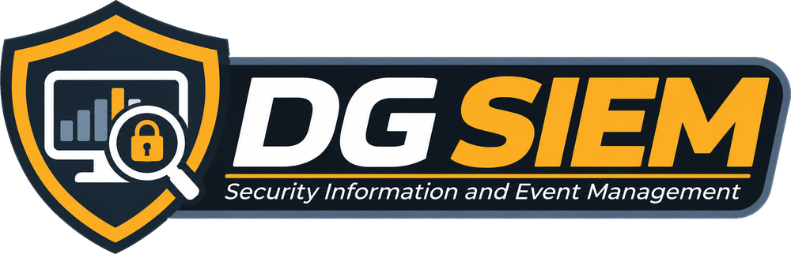
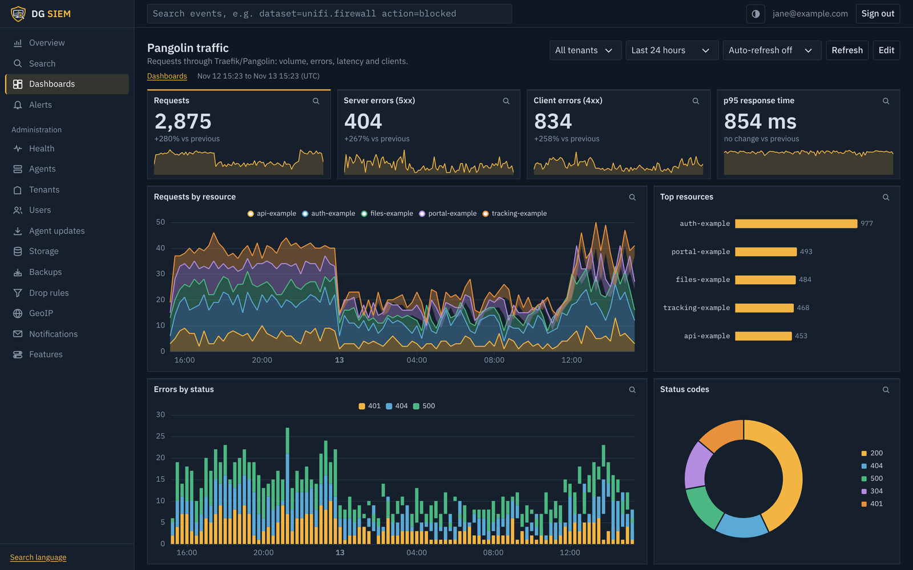
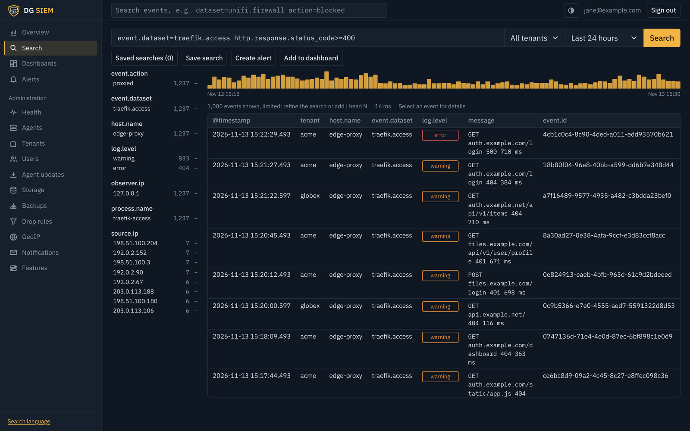
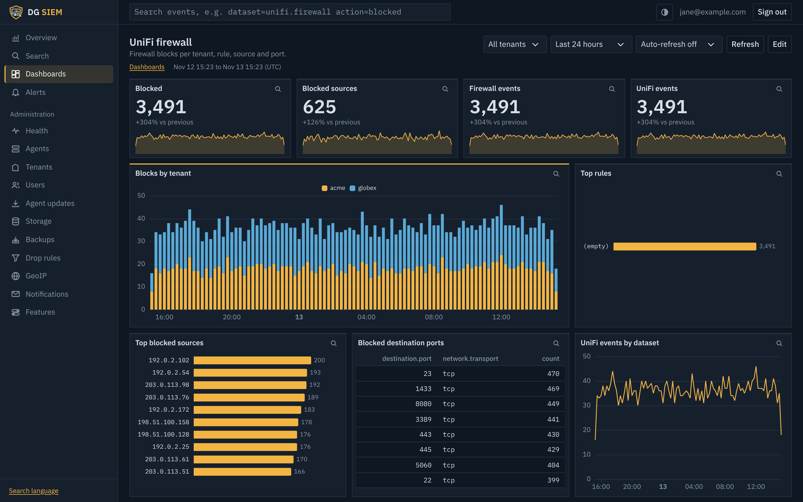

<p align="center"></p>

# DG SIEM

Self-hosted log collection, search, dashboards and alerting for managed service providers (MSPs) and small IT teams, growing into a full SIEM. One small agent per site ships syslog, log files, Windows event logs and HTTP events to one server, which keeps every client's data separate and lets you search it, chart it and get alerted on it.

Built on **.NET 10**, **Blazor**, **ClickHouse** and **PostgreSQL**, and runs as a single `docker compose` stack.

> **Status:** in daily production use at one MSP. Sigma detection rules and cases are next; see the [roadmap](#roadmap). Expect rough edges and breaking changes before 1.0.

<p align="center"></p>

<details>
<summary>More screenshots</summary>





</details>

<sub>Screenshots use generated sample data.</sub>

## What it does

- **Agents for Linux and Windows.** One native binary per site collects syslog (UDP, TCP, TLS), tails log files, reads Windows event logs and accepts events from anything that can send to an HTTP Event Collector. It buffers to disk through outages, talks to the server over mutual TLS, is configured centrally and updates itself.
- **Multi-tenant from the start.** Every event belongs to a tenant (a client), and isolation is enforced twice: in the query compiler and by ClickHouse row policies. Give a client a login that sees only their own logs.
- **Parsers for common MSP gear:** UniFi, Traefik/Pangolin, CrowdSec, authentik, Asterisk/FreePBX, FreeSWITCH/FusionPBX, Windows, plus generic syslog and JSON. Fields use [Elastic Common Schema](https://www.elastic.co/guide/en/ecs/current/index.html) names.
- **Search** with a pipe language (`dataset=unifi.firewall action=block | stats count by source.ip | sort -count`), compiled to parameterized SQL, with a field sidebar, timecharts, event context and saved searches.
- **Dashboards and alerts:** drag-and-resize dashboards, scheduled searches that email you or open tickets in AlgaPSA, and a health page that notices when a log source goes quiet or an agent drops off.
- **Storage that stays affordable:** retention per tenant and dataset, an optional S3 cold tier, GeoIP enrichment, optional threat-intel feeds, and nightly encrypted backups.

## Quick start

You need a Linux host (a VM or LXC is fine) with Docker and the Compose plugin, a few GB of RAM, and disk for your logs.

```bash
git clone https://github.com/dreamingeek/dg-siem.git
cd dg-siem/deploy
cp .env.example .env
```

Edit `.env`: set `POSTGRES_PASSWORD` and `CLICKHOUSE_PASSWORD` (for example with `openssl rand -base64 24`), set `DGSIEM_AGENT_HOSTNAME` to the name your sites will use to reach this server, and set a `DGSIEM_BACKUP_PASSPHRASE` of 12 or more characters. Then start it and create the first administrator:

```bash
docker compose up -d --build
docker compose exec dg-siem-server dotnet dg-siem-server.dll user add you@example.com --admin
# prints a generated password
```

Open `http://<server>:8080`, sign in, and set up two-factor sign-in from your account page (top right). Then:

1. **Administration → Tenants:** add a tenant for each client or site.
2. **Administration → Agents → Enroll an agent:** copy the install command and run it on a Linux machine (or in PowerShell on Windows) at the site.
3. Point your firewalls, switches and servers at the agent's syslog port, or give it log files to tail. Logs appear under **Search** within seconds.

Before exposing it to the internet, put port 8080 behind a TLS reverse proxy and forward port 8443 as raw TCP; see [Running it safely](SECURITY.md#running-it-safely).

## Documentation

| Topic | |
|---|---|
| [Collecting logs](docs/agents.md) | Agent install, inputs, file tailing, HEC, Windows, managing agents |
| [Windows agent](docs/windows.md) | Event logs, install, Sysmon |
| [Agent updates](docs/agent-updates.md) | Uploading versions; agents update themselves |
| [Phones and PBXs](docs/phones.md) | FreePBX/Asterisk and FusionPBX logging |
| [Users and access](docs/users.md) | Accounts, client logins, two-factor, tenant isolation |
| [Search](docs/search.md) | The pipe language and the search page |
| [Dashboards](docs/dashboards.md) | Panels, starter dashboards |
| [Alerting](docs/alerting.md) | Scheduled searches, email, AlgaPSA tickets |
| [Health](docs/health.md) | The health page and quiet-source alerts |
| [Storage](docs/storage.md) | Retention and the S3 cold tier |
| [Backups](docs/backups.md) | Nightly backups and restores |
| [GeoIP](docs/geoip.md) | Country, city and ASN enrichment |
| [Threat intel](docs/threat-intel.md) | Optional blocklist feeds (off by default) |

## Architecture

```
[devices] ─syslog/HEC/file─▶ [dg-siem-agent @ site] ══ mTLS :8443, gzip batches, disk buffer ══▶ [dg-siem-server]
                                                                                              ├─ ingest → parse (ECS) → batch writer ─▶ ClickHouse (events, 120d TTL)
                                                                                              ├─ pipe-language query compiler ◀──────▶ ClickHouse
                                                                                              ├─ Blazor UI: search, dashboards, alerts
                                                                                              └─ users, tenants, agents, saved searches, alerts ─▶ PostgreSQL
```

| Project | Purpose |
|---|---|
| `DreaminGeek.Siem.Core` | Event model, ECS field names, shared contracts |
| `DreaminGeek.Siem.Agent` | `dg-siem-agent`, the per-site collector (Native AOT, systemd) |
| `DreaminGeek.Siem.Parsers` | `IEventParser` plugins: syslog (RFC 5424/3164), UniFi (CEF + firewall), Traefik/Pangolin, CrowdSec, authentik, Asterisk/FreePBX, FreeSWITCH/FusionPBX, Windows event logs, HEC events |
| `DreaminGeek.Siem.Ingest` | Channel-based receive → parse → batch pipeline |
| `DreaminGeek.Siem.Query` | Pipe-language AST, parser and ClickHouse SQL compiler |
| `DreaminGeek.Siem.Storage.ClickHouse` | Schema migrations and batch writer |
| `DreaminGeek.Siem.Data` | PostgreSQL metadata via EF Core + ASP.NET Core Identity |
| `DreaminGeek.Siem.Alerting` | Scheduled searches and actions (email, AlgaPSA ticket) |
| `DreaminGeek.Siem.Web` | `dg-siem-server`: Blazor UI + API host, admin CLI |

### Field naming

DG SIEM uses [Elastic Common Schema](https://www.elastic.co/guide/en/ecs/current/index.html) names (`source.ip`, `user.name`, `event.action`, ...) in queries and the UI. Common fields are promoted to ClickHouse columns with dots replaced by underscores (`source_ip`). Everything else lives in a `fields` map keyed by its ECS name.

## Building from source

Requires the .NET 10 SDK.

```bash
dotnet build DreaminGeek.Siem.slnx
dotnet test DreaminGeek.Siem.slnx
dotnet publish src/DreaminGeek.Siem.Agent -c Release -r linux-x64   # the agent, as a Native AOT binary
```

To run the server outside Docker, point it at PostgreSQL and ClickHouse with `ConnectionStrings__Postgres` and `ClickHouse__ConnectionString` (see `deploy/docker-compose.yml` for the full set of settings). Migrations for both databases run at startup.

## Roadmap

| Phase | Deliverable |
|---|---|
| **0. Foundations** ✅ | Solution, compose stack, ClickHouse + PostgreSQL schemas, CI |
| **1. Ingest** ✅ | Agent: syslog UDP/TCP/TLS, disk buffer, enrollment + mTLS. UniFi and generic syslog parsers |
| **2. Search** ✅ | Pipe language, search UI with surrounding-event context, local auth, tenants, row policies |
| **3. Alerting** ✅ | Scheduled searches → email and AlgaPSA tickets. **MVP** |
| **4. Inputs** | ✅ Traefik/Pangolin, CrowdSec, Authentik parsers; Asterisk/FreePBX, FreeSWITCH/FusionPBX; file tail; HEC endpoint; Windows agent (event logs). Later: desk phones |
| **5. Dashboards** ✅ | Panels over saved queries (replaces Grafana) |
| **6. Tiering** ✅ | Per-tenant/per-dataset retention, S3 cold tier, storage costs, nightly backups |
| **7. SIEM** | ✅ Health page and quiet-source alerts, GeoIP, threat intel (optional). Next: Sigma rules → query compiler, cases |
| **8. Scale-out** | Queue between ingest and writer, multiple ingest nodes, ClickHouse cluster, optional OIDC |

## Contributing

Issues and pull requests are welcome. For anything bigger than a fix, please open an issue first so we can agree on the approach. Run `dotnet build` and `dotnet test` before sending a pull request; the build treats warnings as errors.

## Security

Please report vulnerabilities privately, not in a public issue; see [SECURITY.md](SECURITY.md).

## License and trademarks

[Apache License 2.0](LICENSE). Copyright © Dreamin Geek LLC. The license covers the code, not the DG SIEM name or logo; see [NOTICE](NOTICE).

DG SIEM is an independent project. It is not affiliated with or endorsed by Splunk or Elastic; their names are trademarks of their respective owners and are mentioned only to describe compatibility (the HEC protocol, ECS field names, a familiar query style).
